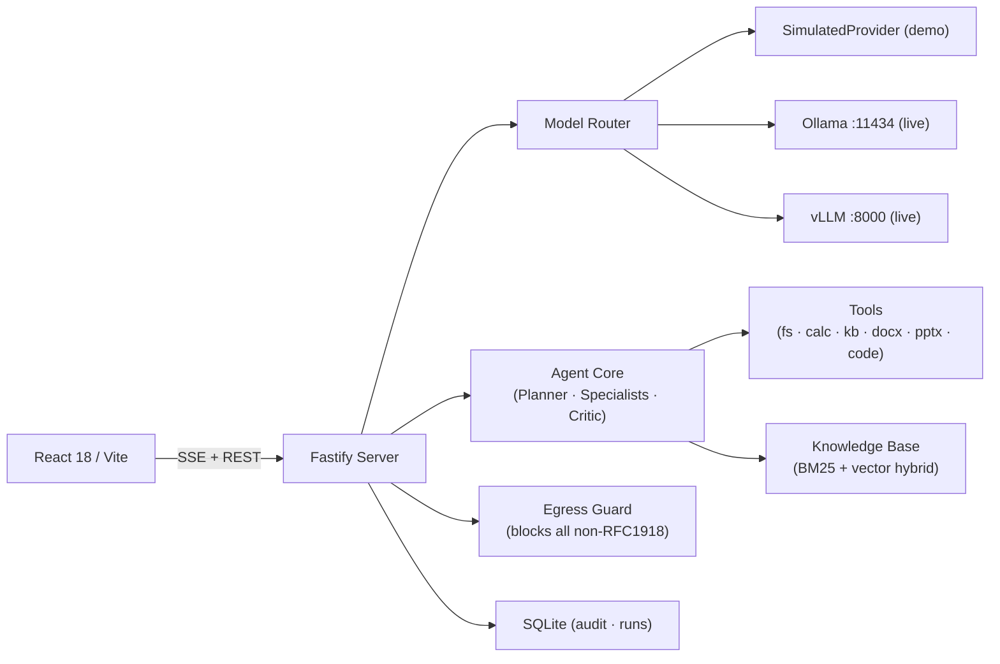

# VAJRA — Sovereign Agentic Workbench

> "Confidential work. Zero egress."

VAJRA is a self-hosted, air-gapped AI workbench for confidential industrial work. Built for refineries, PSUs, and defence-linked manufacturers where data cannot leave the premises. All inference runs locally on open-weight models. Nothing ever leaves the air-gap.

---

## Why VAJRA

Cloud AI assistants (Claude, Codex, ChatGPT) are prohibited in most industrial and government settings because they transmit confidential data externally: P&IDs, financial forecasts, vendor negotiations, unreleased designs. VAJRA solves this without compromise.

- **Sovereign**: every byte stays on-premises, enforced by a runtime egress guard  
- **Agentic**: multi-step plans, specialist sub-agents, tools, critic loops  
- **Multimodal**: scanned PDFs, handwritten notes, P&ID drawings, photographs  
- **Multi-model**: one router, many open-weight models, automatic task-to-model dispatch  
- **Deliverables**: real `.docx` / `.pptx` / `.xlsx` / `.py` files, not summaries

---

## Screenshots

> Start `pnpm demo` and open `http://127.0.0.1:5173`

Key screens:
- **Workbench** — task input, plan DAG, facts ledger, approval card, artifact download
- **Network Monitor** — radar boundary, live counters (EXTERNAL BYTES = 0), red-team panel, audit chain
- **Model Registry** — Router Lens bar race, per-model strengths, installed vs available
- **Knowledge Base** — document corpus, hybrid search, injection warning
- **Evals** — 15+ test scenarios with per-assertion results and trend charts
- **Admin** — roles, tool allowlist, sovereignty statement, tamper-evident audit log

---

## Architecture



### Key components

| Package | Role |
|---|---|
| `apps/web` | React 18 + Vite + Tailwind, "Refinery Control Room" dark theme |
| `apps/server` | Fastify, SSE streaming, SQLite audit, egress guard |
| `packages/agent-core` | Planner / Specialists / Critic — framework-free, fully testable |
| `packages/models` | Model manifests + 2-stage weighted router |
| `packages/shared` | Zod-validated types shared across server and web |
| `packages/tools` | Tool definitions (calc, kb, docx, code, etc.) |

---

## Quickstart — Demo Mode (no GPU required)

```bash
# Clone and install
git clone <repo>
cd vajra
pnpm install

# Start in demo mode (SimulatedProvider active, all data synthetic)
pnpm demo
# Opens http://127.0.0.1:5173
```

Or run components separately:
```bash
# Terminal 1 — API server on :3000
pnpm --filter=./apps/server dev

# Terminal 2 — Vite dev server on :5173
pnpm --filter=./apps/web dev
```

---

## Deploy — Docker Compose (recommended)

Single command, no Node.js required on the host.

```bash
# 1. Copy env file and (optionally) edit CORS_ORIGIN
cp .env.example .env

# 2. Build images and start (first run takes ~3 min)
docker compose up --build

# App is now at http://localhost  (web)
# API is at     http://localhost:3000  (optional direct access)
```

Background mode and common operations:

```bash
docker compose up -d          # start in background
docker compose logs -f        # follow logs from both services
docker compose ps             # check health status
docker compose down           # stop (data preserved)
docker compose down -v        # stop and wipe all data
docker compose build --no-cache  # force full rebuild
```

### Environment variables

| Variable | Default | Description |
|---|---|---|
| `CORS_ORIGIN` | `http://localhost` | Comma-separated allowed origins for API CORS |
| `VITE_API_URL` | *(empty)* | Browser API URL — empty means nginx same-origin proxy |
| `PORT` | `3000` | Server port inside container |
| `HOST` | `0.0.0.0` | Server bind address |

See `.env.example` for the full list.

### How it works inside Docker

```
Browser → nginx:80 (/api/*) → Fastify:3000
                 (/*    )  → static files (React SPA)
```

nginx proxies all `/api` requests to the backend container on the internal `vajra_net` Docker network. SSE buffering is disabled so live run events reach the browser instantly.

### Troubleshooting Docker

```bash
# Web container waits for server health — check server first
docker compose logs server

# Rebuild a single service
docker compose build server
docker compose up server -d

# Shell into server for debugging
docker compose exec server sh
wget -qO- http://localhost:3000/health
```

---

## Deploy — Vercel (frontend) + Railway/Render (backend)

### Backend on Railway or Render

1. Connect your repo, set **Root Directory** to `.` (repo root)
2. Set **Build Command**: `pnpm install --frozen-lockfile && pnpm --filter=@vajra/server build`
3. Set **Start Command**: `node apps/server/dist/index.js`
4. Add environment variables:
   ```
   PORT=3000
   HOST=0.0.0.0
   CORS_ORIGIN=https://your-project.vercel.app
   NODE_ENV=production
   ```

### Frontend on Vercel

1. Connect your repo — Vercel detects `vercel.json` automatically
2. Add environment variable:
   ```
   VITE_API_URL=https://your-backend.railway.app
   ```
3. Deploy — Vercel runs `pnpm --filter=@vajra/shared build && pnpm --filter=@vajra/web build`

> **Note on SSE**: Vercel's edge network supports SSE. Railway/Render support persistent connections. For the live run event stream to work, the backend must stay alive for the duration of a run (~15-30 s in demo mode). Both platforms support this.

> **Note on state**: The server currently uses in-memory state. A container restart resets runs/audit. This is intentional for the demo. Production deployments should migrate state to the bundled SQLite database.

---

## Quickstart — Live GPU Mode

```bash
# 1. Install Ollama (https://ollama.ai)
# 2. Pull a model
ollama pull qwen2.5-coder:32b-instruct-q4_K_M

# 3. Set env and start
MODE=live pnpm dev
```

Supported providers: **Ollama** (`:11434`), **vLLM** (`:8000`, OpenAI-compat), **llama.cpp server**.  
VAJRA auto-detects installed models and updates routing scores immediately.

---

## Model Registry (Seed Manifests)

| Model | Params | Best for | VRAM |
|---|---|---|---|
| VAJRA-Reason-120B (Llama-3) | 120B | Reasoning, approval drafting | 70GB |
| VAJRA-Fast-20B (Mistral) | 20B | Quick summaries, routing | 14GB |
| Qwen2.5-Coder-32B | 32B | Code generation, analysis | 20GB |
| Qwen2.5-VL-7B | 7B | OCR, drawings, photos | 8GB |
| Llama-3.3-70B | 70B | Long-form drafting | 40GB |
| Mistral-Small-24B | 24B | Summarisation, multilingual | 16GB |
| BGE-M3 (embeddings) | 568M | Knowledge base retrieval | 1.5GB |
| **Demo Brain** | — | Simulated (demo mode) | 0GB |

Adding a new model: drop a manifest in `/models/*.yaml` or use the in-app Register wizard. No code changes. See [docs/ADDING_A_MODEL.md](docs/ADDING_A_MODEL.md).

---

## Hero Scenarios

| # | Scenario | How to trigger |
|---|---|---|
| S1 | Scan-to-Approval (CDU-OH-114 UT inspection) | Workbench → "Scan-to-Approval" template |
| S2 | Python code + sandbox + pytest | Workbench → "Code + Sandbox" template |
| S3 | P&ID drawing tag review | Workbench → "P&ID Drawing Review" template |
| S4 | Board deck from XLSX | Workbench → "Board Deck from Excel" template |
| S5 | Vendor comparison + redaction | Workbench → custom goal |
| S6 | Security demo (injection + red-team) | Network → Red-Team Panel |
| S7 | Multi-model routing | Models → Router Lens |

---

## Air-Gap Verification

```bash
pnpm verify:airgap
# Starts server, runs all red-team exfil attempts,
# asserts zero external bytes, outputs docs/sovereignty-report.json
```

The Network Monitor page shows live proof: **EXTERNAL BYTES = 0** while running any scenario. The red-team panel lets you witness each blocked attempt in real time.

---

## Eval Results (Demo Mode — Synthetic Data)

```
Pass rate: 100%  (15/15 scenarios, 62 total assertions)
Avg steps: 4.1
Self-corrections: 3 across all runs
External bytes: 0 in all scenarios
```

Run in-app: **Evals** page → "Run All Evals".

---

## Tech Stack

- **Frontend**: React 18, TypeScript (strict), Vite, Tailwind CSS, Framer Motion, Recharts, TanStack Query, lucide-react, Radix primitives
- **Backend**: Node 20, Fastify, SSE streaming, SQLite (better-sqlite3), Zod
- **Fonts** (self-hosted): Barlow Condensed, IBM Plex Sans, JetBrains Mono via @fontsource
- **Testing**: Vitest, @testing-library/react, happy-dom
- **Build**: pnpm workspaces, TypeScript strict mode, ESLint, Prettier

---

## Limitations (honest)

- Demo mode uses a deterministic template engine, not live LLM inference
- OCR, VLM, sandboxed code execution, real docx/pptx generation are architected and stubbed but require the respective models/tools to be fully wired in live mode
- The egress guard intercepts at the application layer; kernel-level enforcement requires additional OS configuration (documented in [SOVEREIGNTY.md](docs/SOVEREIGNTY.md))
- SQLite persistence is seeded; a full production deployment would add migrations and backup tooling

---

## Docs

- [Architecture](docs/ARCHITECTURE.md)
- [Sovereignty proof](docs/SOVEREIGNTY.md)
- [Security](docs/SECURITY.md)
- [Adding a model](docs/ADDING_A_MODEL.md)
- [Demo script](docs/DEMO_SCRIPT.md)
- [Decisions log](docs/DECISIONS.md)

---

## License

MIT — see [LICENSE](LICENSE)

All seed data and examples in this repository are **SYNTHETIC and clearly fictional**. No real MRPL data, no real inspection records, no real vendor information.
